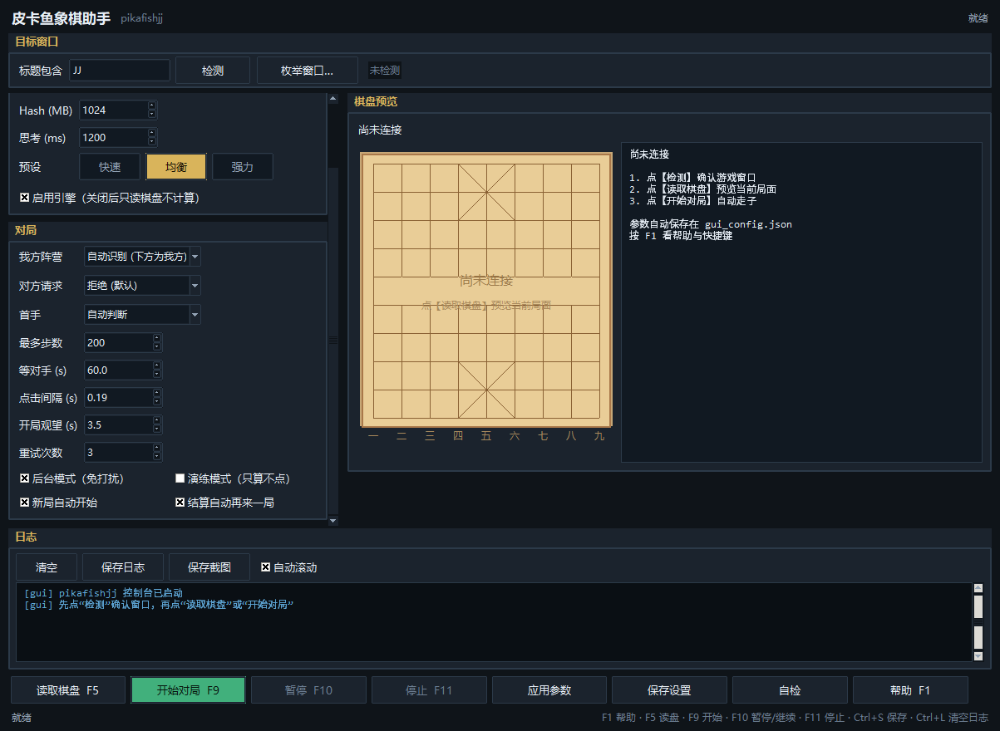

# pikayu-jj · 皮卡鱼象棋助手

把开源的 **Pikafish** 中国象棋引擎接到窗口化的象棋程序（微信小程序 **JJ象棋**）上，在本机上实现**截屏识别 → 引擎计算 → 模拟点击**的全自动对弈。

程序**不注入、不挂钩、不改包、不读内存、不抓协议**——只读屏幕像素、只发送鼠标点击，对目标进程完全无侵入。

> **使用前必读**：[DISCLAIMER.md](DISCLAIMER.md)（法律声明与免责条款，独立适用、强制约束）。仅限自有设备、自有账号、自己的窗口，仅限学习研究与个人测试；禁止对真人对手、禁止违反平台规则、禁止商业用途。继续使用即视为已接受该文件全部条款。



---

## 特性

| 能力 | 数据 |
| --- | --- |
| 局面识别 | 开局 **90/90 格全对**；中局与屏幕逐子相符（NCC 最低 0.78，类别区分度 0.25+） |
| 读屏速度 | 冷启一次约 **28 ms**；连帧增量识别 **3.7–4.6 ms**（优化前 64 ms） |
| 标定 | 0.2–0.9 s，仅启动时一次 |
| 引擎 | Pikafish，预设「强力」= 16 线程 / 3 GB Hash / `go movetime 3000` → 深度 16–26，nps 3–5 M |
| 稳定性 | 走子失败自动重试、引擎崩溃自动重启、窗口被挡自动重定位、棋钟纪律、对手求和/悔棋自动应答、自动「再来一局」 |
| 静默运行 | 后台模式：窗口被遮挡也能读，点击不抢焦点、指针自动归位 |
| 界面 | tkinter 深色控制台：参数面板 + 棋盘预览 + 实时日志 + 统计；快捷键 F1/F5/F9/F10/F11 |

## 下载即用（推荐）

不需要 Python。到发行版（`pikafishjj/dist/`）取：

```
pikafishjj.exe            # 单文件程序，双击打开控制台
pikafishjj-win64.zip      # 同上 + 使用说明.txt + gui_config.json
使用说明.txt               # 面向使用者的图文说明
```

1. 在独立窗口中打开 JJ象棋（窗口标题含 `JJ`），停留在棋盘页面。
2. 双击 `pikafishjj.exe` → 点【检测】确认找到窗口 → 点【读取棋盘】核对预览 → 点【开始对局】。
3. 想不被打扰：勾选「后台模式（免打扰）」再开始。

运行要求：64 位 Windows 10/11；首次运行会在程序目录释放引擎（约 57 MB），稍等几秒。

## 从源码运行

```powershell
# 依赖：Python 3 + numpy（识别）、Pillow（仅重建模板包时需要）、tkinter（Python 自带）
python -m pip install numpy pillow

# 工作目录 = 仓库里的 pikafishjj/
cd pikafishjj

python -m pikafishjj.run ui                     # 图形控制台（等价于双击仓库根的 pikafishjj-ui.bat）
python -m pikafishjj.run probe --title JJ       # 只读侦察：抓一帧、标定、识别、打印棋盘与 FEN，不动鼠标
python -m pikafishjj.run play --title JJ --first me --movetime 1500 --max-moves 200
python -m pikafishjj.run play --title JJ --background   # 后台模式
```

命令行选项、GUI 详解、重试策略、工作原理、调参指南见 **[pikafishjj/README.md](pikafishjj/README.md)**（480 行开发文档）。

## 目录结构

```
.
├── pikafishjj/
│   ├── pikafishjj/            # 程序包
│   │   ├── vision.py          # 标定 / 模板匹配 / 增量识别
│   │   ├── auto.py            # 对局循环、重试、棋钟纪律、续局
│   │   ├── engine.py          # UCI 引擎封装
│   │   ├── board.py           # 局面 / FEN / 差分
│   │   ├── bridge.py          # 两条轴（视觉轴 + 内存轴）与内存读取器
│   │   ├── dialog.py          # 求和 / 悔棋面板识别与应答
│   │   ├── w32.py             # Win32 抓屏、模拟点击、窗口管理
│   │   ├── gui.py             # tkinter 控制台
│   │   ├── run.py             # 命令行入口
│   │   ├── book.py            # 开局库
│   │   └── templates.npz      # 棋子模板包
│   ├── tools/                 # 包内单元测试 t_*.py（11 项）
│   ├── dist/                  # 交付物：exe / zip / 使用说明
│   ├── pikafishjj.spec        # PyInstaller 打包配置
│   └── README.md              # 开发文档
├── pikafish/                  # Pikafish 引擎 + NNUE 权重（第三方，见许可）
├── tools/                     # 诊断与回归脚本、模板包重建、发行包刷新
├── fixtures/                  # 测试夹具截图
├── dbg/                       # 排查与复现脚本、run_suite.sh
├── docs/                      # 交付截图、引擎许可文本、内存取盘面调研
├── assets/                    # 图标源
├── logs/                      # 构建与回归日志（SUITE_FAILURES=0 即全绿）
├── pikafishjj-ui.bat          # 开发态启动器
├── LICENSE                    # GPLv3
└── DISCLAIMER.md              # 法律声明与免责条款
```

## 构建与测试

```powershell
# 全部 19 个套件（明细写 logs\new_*.log，汇总写 logs\suite_new.txt）
bash dbg\run_suite.sh

# 或手工
$tests = 't_time','t_bg','t_wait','t_rematch','t_newgame','t_retry','t_gui','t_book','t_stop','t_bridge','t_audit'
foreach ($t in $tests) { python "pikafishjj\tools\$t.py" }
$tests = 't_gate','t_lift','t_regress','t_coarse','skin_bench','t_cal_fuzz','t_incr2','t_dialog','t_dialog2'
foreach ($t in $tests) { python "tools\$t.py" }

# 打包（工作目录 = pikafishjj\），再刷新 zip 并自检
python -m PyInstaller --noconfirm --clean pikafishjj.spec
python tools\make_zip.py
.\pikafishjj\dist\pikafishjj.exe selftest --frame fixtures\jj_endgame1.png
```

> 回归脚本里写死了作者本机的解释器路径，换机器时把 `$PY` 改成自己的 `python`。

## 许可

| 内容 | 许可 |
| --- | --- |
| 本项目源码 | [GNU GPL v3.0](LICENSE) |
| 法律声明与使用限制 | [DISCLAIMER.md](DISCLAIMER.md)（GPLv3 第 7 条附加条款，独立适用） |
| Pikafish 引擎 | GPLv3，见 [pikafish/Copying.txt](pikafish/Copying.txt)、[pikafish/AUTHORS](pikafish/AUTHORS) |
| `pikafish.nnue` 权重 | [NNUE-License.md](pikafish/NNUE-License.md)：仅限合法用途，未经许可不得商业使用 |

再分发本项目时，须保留 `LICENSE`、`DISCLAIMER.md` 与第三方许可文本，并公开修改后的完整源码。

## ⚠️ 免责

本项目**按"现状"提供，不附带任何担保**。使用者自行承担全部使用风险；因违反第三方规则、当地法律或本条款所引发的一切后果（含账号处罚、索赔、诉讼）**由使用者自负**，并须对作者、维护者与贡献者**完全免责并赔偿**。完整条款见 [DISCLAIMER.md](DISCLAIMER.md)。

本项目与 Pikafish 项目、腾讯、JJ象棋及任何商业实体**均无隶属、授权、合作或背书关系**；文中所有商标与商品名归各自权利人所有，仅作兼容性说明。
