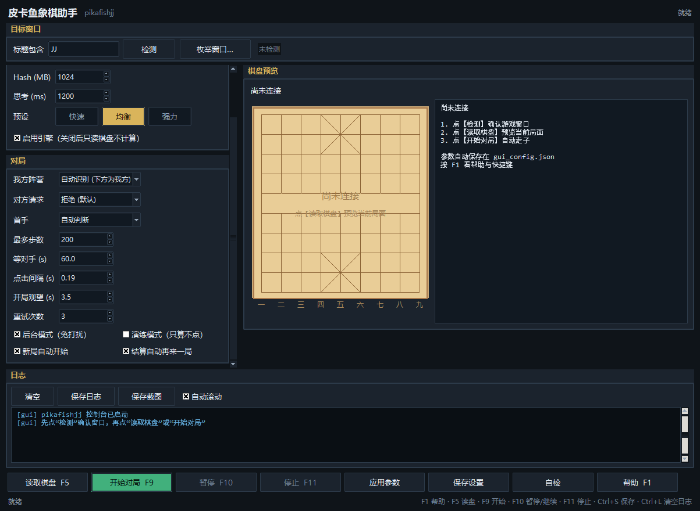

# pikafishjj

把 **Pikafish** 中国象棋引擎接到微信小程序 **JJ象棋** 上，实现全自动对弈。程序不注入、不挂钩、不改包，只通过 **截屏识别 + 模拟鼠标点击** 操作窗口，因此对游戏进程完全无侵入。

## 效果

- 实时局面识别：**开局 90/90 格全对；中局实测与屏幕逐子相符**（NCC 最低 0.78，类别区分度 0.25+）。
- 一次读屏（抓屏 + 识别）冷启 **约 28 ms**、连帧**增量识别 3.7–4.6 ms**（优化前 64 ms）；标定 0.2–0.9 s，只在启动时做一次。
- 引擎：Pikafish 2026-09-06；预设「强力」= 16 线程 / 3GB Hash / `go movetime 3000` → 深度 16–26，nps 3–5 M。
- 实测已连续自动走子 30+ 步（含吃子、被吃、对手抢答、稀疏残局），链路无人工干预。
- 自带 **tkinter 图形控制台**：参数面板 + 棋盘预览 + 实时日志 + 统计，见下文。

### 性能（同一实时窗口 598x1119 @ (1913,95)，Ryzen 7 5700X3D）

| 指标 | 优化前 | 现在 |
| --- | --- | --- |
| 一次 `read`（抓屏 + 识别） | ~64 ms | **27.6 ms**（冷启）／**约 16 ms**（连帧增量：抓屏 12 ms + 识别 4 ms） |
| `recognize` | 52.7 ms | **16.9–28 ms** |
| `recognize`（连帧增量，只重算变了的格子） | — | **3.7–4.6 ms** |
| `cell_box_scores`（占用判定） | 37.5 ms | **10.8 ms** |
| `stable_grid` 等棋盘落定 | ~420 ms | **0.196 s** |
| 8 ply 对局的识别次数 | 85 | **45** |

四处优化：

1. **ROI 积分图**：占用判定只在棋盘带的外扩矩形内做 `sum(RGB)` + cumsum，不再对整帧做 float64 积分图（与全帧版逐格对比 max diff = 0.000000）。
2. **提示式模板匹配**：上一帧的偏移量作为提示，只在它 ±1px 内搜（9 个候选而不是 81 个），单格 1.22 ms → 0.33 ms，结果与全搜逐格相同。
3. **静止闸门**：先等画面静止（按 8x8 块统计变化像素，棋盘带内静止 ≤3 块、动画 ≥20 块）再识别一次，而不是动画期间每帧都跑识别。
4. **增量识别**：一帧读完后记住每格与棋盘底色的距离、每格认到的棋子与偏移；下一帧先做 90 格逐格差分（约 1 ms），只有像素真变了的格子（一手棋 = 2 格，上限 20 格）才重算占用与匹配，其余沿用上一帧。实测与全量**逐格完全相同**（56.7 ms → 3.7–4.6 ms）；差分格数超上限、或上一帧局面不合法时自动退回全量。

## 依赖

- Windows + 已打开的 JJ象棋 小程序窗口（标题含 `JJ`）。
- Python 3 + numpy（无需 opencv / scipy）。构建模板包时需要 Pillow。
- 引擎：`pikafish\Pikafish-Windows-x86-64-universal.exe` + 同目录 `pikafish.nnue`。

默认解释器（本机已验证）：

```
D:\dshdesktop\DSH Desktop\resources\office-runtime\primary-runtime\dependencies\python\python.exe
```

## 用法

所有命令的工作目录是 **包的外层** `D:\BuildProject\pikayu-jj\pikafishjj`：

```powershell
# 图形控制台（推荐）
python -m pikafishjj.run ui
# 等价于双击 D:\BuildProject\pikayu-jj\pikafishjj-ui.bat

# 只读侦察：抓一帧、标定、识别、打印棋盘和 FEN，不动鼠标
python -m pikafishjj.run probe --title JJ

# 自动对弈
python -m pikafishjj.run play --title JJ --first me --movetime 1500 --max-moves 200

# 后台模式：窗口可以不是前台窗口（被挡住也能读；点击不抢焦点、指针自动归位）
python -m pikafishjj.run play --title JJ --background

# 自检：模板包 / 引擎 / 识别 三件事各跑一次（0 = 通过，3 = 有问题）
python -m pikafishjj.run selftest --frame jj-frame.png
```

`play` 参数：

| 参数 | 默认 | 说明 |
| --- | --- | --- |
| `--title` | `JJ` | 窗口标题子串 |
| `--first` | 自动 | `me` = 轮到我们先走；`them` = 先等对手；省略则自己判断 |
| `--movetime` | 2000 | 每步思考毫秒数（**不要用 `go nodes`，该版本不遵守**） |
| `--threads` / `--hash` | 8 / 1024 | 引擎线程数与 Hash MB |
| `--max-moves` | 200 | 我方最多走多少步 |
| `--exe` | 内置路径 | 引擎可执行文件 |
| `--dry` | 关 | 演练：思考一步、打印落点与屏幕坐标后结束，不点鼠标 |
| `--background` | 关 | 后台操作：PrintWindow 读棋盘（被遮挡也能读）、点击不抢前台、指针自动归位；落点被盖住时点击前会临时把游戏窗口置顶 |
| `--request` | `decline` | 对手求和 / 悔棋弹窗怎么答：`decline` 拒绝、`accept` 同意、`off` 不处理 |
| `--retries` | 3 | 一次走棋失败（点击没落地 / 引擎没返回着法）最多重试几次，1~10 |
| `--no-auto-next` | 不勾 | 关掉「结算屏自动点【再来一局】」，默认是自动接着下 |

## GUI 控制台



默认 1150x880，窗口最小 1000x760（再矮就会遮住棋盘预览的最后一行）。窗口大小与位置会记在 gui_config.json 里，下次打开照旧。

`python -m pikafishjj.run ui`（或双击 `pikafishjj-ui.bat`）打开：

```
┌ 皮卡鱼象棋助手  pikafishjj                                就绪 ┐
├ 目标窗口 ───────────────────────────────────────────────────┤
│ 标题包含 [JJ      ] [检测] [枚举窗口…]   598x1119 @ (1913,95) │
├ 引擎 ─────────────────┬ 棋盘预览 ───────────────────────────┤
│ 引擎 exe [……]  [浏览] │ 我方 红方（下）      模板包：14 类   │
│ 线程数 / Hash / 思考  │ ┌──────────┬──────────────────────┐ │
│ 预设 [快速][均衡][强力]│ │ 棋盘局面  │ 局面/我方/阶段       │ │
│ ☑ 启用引擎            │ │ 上一手：绿圈起点      读帧/耗时/增量 │ │
├ 对局 ─────────────────┤ │ 红圈落点   │ 最优/评分/nodes/nps  │ │
│ 我方阵营 / 对方请求   │ └──────────┴──────────────────────┘ │
│ 先手 / 最多步数       │                                      │
│ 等对手 / 点击间隔     │                                      │
│ 开局观望 / 重试次数   │                                      │
│ ☐ 后台模式 ☐ 演练模式 │                                      │
│ ☐ 新局自动开始        │                                      │
│ ☐ 结算自动再来一局    │                                      │
├ 日志 [清空][保存日志][保存截图][☑ 自动滚动] ──────────────────┤
│ [best] e1d2 depth=16 cp=407 nodes=1591234                    │
└──────────────────────────────────────────────────────────────┘
[读取棋盘 F5][开始对局 F9][暂停 F10][停止 F11][应用参数][保存设置][自检][帮助 F1]
```

按钮语义：

| 按钮 / 控件 | 作用 |
| --- | --- |
| **读取棋盘** (F5) | 抓一帧 → 标定 → 识别 → 预览 + 信息面板，不点鼠标、不启引擎 |
| **开始对局** (F9) | 起后台线程跑完整主循环（引擎 + 点击） |
| **暂停** (F10) | 在走子间隙挂起，当步走完才停，再点恢复 |
| **停止** (F11) | 置停止标志，当前步完成后退出线程并 quit 引擎 |
| **应用参数** | 不重启线程，把新参数（思考时间、点击间隔、重试次数、自动再来一局等）推给正在跑的 player |
| **保存设置** (Ctrl+S) | 写入 gui_config.json（含窗口大小位置），下次启动自动载入 |
| **自检** | 依次验证模板包、引擎（跑一次开局搜索）、当前窗口识别；没开游戏也能测引擎与模板 |
| **帮助** (F1) | 快速上手、快捷键、关键参数、常见问题 |
| 预设芯片 **快速 / 均衡 / 强力** | 一键改线程数 / Hash / 思考时间，当前预设金色高亮 |
| 日志工具条 | 清空 (Ctrl+L) / 保存日志 / 保存截图 / 自动滚动 |
| 目标窗口卡片 | 「检测」找到游戏窗口并显示客户区与 hwnd；「枚举窗口…」从列表里挑 |

快捷键：

| 键 | 作用 |
| --- | --- |
| F1 | 帮助 |
| F5 | 读取棋盘 |
| F9 | 开始对局 |
| F10 | 暂停 / 继续 |
| F11 | 停止 |
| Ctrl+S / Ctrl+L | 保存设置 / 清空日志 |

界面为深色卡片式：左栏（引擎、对局）可滚动，右栏是棋盘预览与实时信息面板，下面分色日志（绿＝走子成功、黄＝等待/警告、红＝错误）。

参数说明：

| 键 | 默认 | 说明 |
| --- | --- | --- |
| `title` | `JJ` | 窗口标题关键字 |
| `exe` | `…\pikafish\Pikafish-Windows-x86-64-universal.exe` | 引擎路径（同目录需有 `pikafish.nnue`） |
| `threads` / `hash_mb` | 8 / 1024 | 引擎线程数与 Hash；预设 快速 4/256/400、均衡 8/1024/1200、强力 16/3072/3000 |
| `movetime` | 1200–3000 | 每步思考毫秒（该版本不遵守 `go nodes`） |
| `side` | 自动识别 | **自动识别**＝棋盘**下半部分**那一方就是我方（小程序永远把自己的军队画在下半盘）：红在下 → 我执红，红在上（翻转过）→ 我执黑。也可手动指定 `w` 红方先手 / `b` 黑方后手 |
| `first` | 自动 | 自动判断＝开局面且执红就直接走，否则先观望；也可强制 `me` / `them` |
| `max_moves` | 200 | 我方最多走多少步 |
| `opp_timeout` | 60 | 等对手一手的秒数 |
| `probe_wait` | 3.0 | 启动时观望秒数 |
| `click_delay` | 0.18 | 起点、终点两次点击之间的间隔 |
| `dry` | 关 | 演练：思考一步、打印落点与屏幕坐标后结束，不点鼠标 |
| `background` | 关 | 后台模式（免打扰）：勾选后窗口被挡住也能读棋盘，点击不抢前台；游戏窗口被别的窗口盖住时，点击前会临时置顶（会闪一下） |
| `request` | 拒绝 | 对手求和 / 悔棋弹窗怎么答：拒绝（默认）/ 同意 / 忽略（不处理，游戏会一直等着） |
| `retries` | 3 | 一步棋失败后的重试次数（1~10）：点击没落地就再点一次同一着法，引擎崩了就重启引擎重算 |
| `auto_next` | 开 | 结算屏自动点【再来一局】并持续识别；新的一局摆好棋子后自动接着下 |
| `geometry` | 自动记忆 | 窗口大小与位置，关闭 GUI 时写回；想恢复默认就删掉这一项（默认 1150x880） |

> Hash 越大首次搜索越慢：3GB Hash 的第一次 `go` 要多花约 2 秒做内存初始化，属正常现象。
> 选错「先手」会让程序白等满 `opp_timeout`（日志 `[wait] no opponent move in 60s`），保持「自动判断」即可。

## 走棋重试与自动续局

一局里任何一次走棋失败都不会让程序停住不动，失败路径全部有恢复动作：

| 失败 | 程序怎么办 |
| --- | --- |
| 点击没落地（棋盘上没出现我方这一步） | 同一着法再点一次，最多 `retries` 次；后台模式下这次重试改走普通点击，但只挂起静默点击 6 秒，之后自动回来（不会永久变前台） |
| 引擎进程崩了 / 超出等待时间没返回 `bestmove` | `restart_engine()`：quit 旧进程、起新进程，然后重新思考同一步 |
| 引擎说没有着法可走 | 先复核棋盘：棋盘变了就采纳对手的着法继续；没变就恢复一次再问引擎，连续失败才认为这一局结束 |
| 读不到棋盘（被挡住 / 最小化 / 切到了别的界面） | `recover()` → `reattach()`：重新找窗口、重建抓帧器、重新标定，再继续 |
| 点击多次仍不落地 | 停止点击，进入「只观察」模式（`[stall] ... watching instead of clicking`），等棋盘有变化再接手；点【停止】可结束 |
| **等对手走 + 我方黑棋开局（保守口径）** | 真的**等**：对方没动就一直等到 `opp_timeout`，超时后由既有路径把回合交回来再下。**不伪造走法**——伪造走法会让程序在自己的回合里站着不动、把棋钟耗光（这正是「优化 使用均衡模式 不走棋」的根因）。日志：`[start] the board is not at the starting position and the first-move setting says the opponent plays first - waiting for their move, then playing on our turn` |
| **中途暂停 / 停止** | 立刻生效（实测 ≤0.35s）：`_start_watch()` 的看门线程在按键后 ≤50ms 调 `Engine.stop()`，用写锁发 UCI `stop` 打断正在思考的搜索（搜索锁被 `bestmove()` 持有，不能等它）；循环里所有 sleep 改成 50ms 片段（`_sleep`）；`settle_after`/`wait_still`/`wait_next_round` 每轮先过 `_pause_gate()`；`recover()` 在已停止时直接返回，不再重标定或重启引擎 |
| 对手长时间不走 | 20 次空等后做一次恢复，日志继续刷心跳，永远不自己退出 |
| **我方这一步一直没落地**（点击被吞、不是我们的回合、画面在重绘） | **不再把回合交还给对手空等**（旧代码在这里等满 `opp_timeout=60s`，而我们的棋钟一直在走 —— 2026-10-13 的「偶尔不会操作、被判超时」就是它）：现在改成**一个有界的回合**：看盘 `STALL_WATCH=4s`（每 3 次失败 +3s，上限 15s）→ 对手真走了就接过来 → 没走就**重新思考、重新落子**。提示行 `[stall] nothing moved and it is our turn - thinking again (our clock is running)` |
| **开局思考耗时**（每步 0.4s 纯浪费） | 内置精简开局库 book.py：前 12 ply 直接按局面查表（h2e2 等主流着法），**不搜索**；查表按「从开局重放该行是否到达当前 FEN」判定，所以中途重连/续局也能用；超出深度或行不匹配就交给引擎。可用 book_path 换成转换好的 OBK/JSON 行库 |
| 引擎卡死 / 不再回答 | `bestmove` 的等待上限从固定 10s 改成跟思考时间成比例（`max(4, movetime*4+3)`，400ms 思考 → 4.6s），失败后立刻重启引擎；三次重试都拿不到着法才认为这局结束 |
| 自己这一步花了多久 | 每次成功落子都会打 `[play] confirmed c3 -> c4 in 1.2s`；超过 `SLOW_MOVE_WARN=8s` 会打 `[time] that turn cost ... of our clock`。信息面板「用时」一行显示 `我方累计 / 最慢一步 / 慢步次数`，「重试」一行多了 `卡住 N`（stall 次数） |
| 落子后棋盘一直在重绘（等不到连续静止帧） | `stable_grid()` 先等静止帧；超过 `REPAINT_PATIENCE=1.2s` 没等到就退化为「两次读数完全一致就认」（撕裂帧不会一模一样地重复，真实局面会），消掉每步之后几秒的识别盲区 |
| 等待期间棋盘一次多了好几手（对手应手 + 手动补的一步） | 差异能用整手数解释（`B.explain_change`：每一手都是「同一枚棋子离开一格、落到空格或被吃子的格」）并且同一张盘过 `MULTI_PLY_CONFIRM=1.5s` 再读一次仍在，就采纳并继续；解释不通的（棋子凭空消失、原地变了字）只当候选继续看，不喂给引擎 |
| 连续 3 帧都不像棋盘 | 先按【再来一局】（多半在结算屏），并尝试重标定一次；重标定后**同一帧**仍读不出棋盘就保留原来的标定（说明只是被挡/在动画） |
| 屏幕上的棋盘明显比我们正在下的那块小 | 不读它：`_pitch_off()` 拿「对局中那块盘」的格距当尺子，拒绝缩小/放大的同款盘（结算屏会把棋盘缩小约 20%），从而走【再来一局】那条路 |
| 窗口被改了大小、棋盘真的换了尺寸 | 连续 `PITCH_RELEARN=12s` 都读到另一个尺寸就改认新尺寸（并打印它），不会永远拒读 |

等待期间每 2~10 秒有一行心跳（`[wait]` / `[read]` / `[retry]` / `[stall]`），信息面板的「重试」一行实时显示 `落子重试 / 恢复 / 失败` 三个计数。**等对手时的心跳分两种**，免得用户以为卡死：「the position is the same as our last reading (Ns of Ms) - the opponent has not moved yet」（读得出来、局面没变）与「the board cannot be read yet (Ns of Ms) - the app is repainting or showing another screen」（读不出来：在动画、被挡、或者切到了别的界面）。

结算屏：一局结束后游戏会切到缩小变暗的棋盘 + 底部绿色【再来一局】。`dialog.find_continue()` 只在画面底部 16%（`CONT_FRAC=0.84`）找绿色实心胶囊（宽 0.22~0.80W、实心度 ≥0.55），**如果同一行还有一段宽度 ≥绿块 40% 的红块就判定为对手求和面板并放行给 `find_request()`**，不会把【同意】当【再来一局】点掉。命中后 `handle_continue()` 3 秒内只点一次，`wait_next_round()` 接着抓帧等新局（认到初始局面或和我记的棋盘不同就返回）。顺带解决的还有：标定连续失败时 `stable_grid()` 会调 `handle_continue()`，所以停在结算屏时也会自己开下一局。

**按过【再来一局】之后的新局是「按帧认」的**（`waiting_new_round()`，窗口 `NEW_ROUND_WINDOW=60s`）：排名局会换边，新一局可能整个转 180° 画出来，甚至对手已经先走了一两步，所以这段时间**不再要求「正好差一手」，也不要求认成标准开局** —— 只要是可读、且与刚结束的那局不同的棋盘，就用这一帧重新推朝向（`B.detect_flip`）、重新定我方阵营（`our_side`），并清掉增量识别链与点击提示；结果屏本身（和记的棋盘一模一样）不算新局，不会被误当成开局。没有这道口子时实测是：新局被当成 33 格同时变化的「implausible jump」刷屏、而且永远进不去（用户日志里那一墙字就是这么来的）。同一段时间里 `handle_dialog()` 有两道闸：点完【再来一局】后 **8 秒**内不认任何「对手请求」面板；之后同一个按钮位置要**连续看到 3 次、跨度满 1.0 秒**才点（只有 1 个按钮的版本更严：4 次、2.5 秒）。原来的「两帧确认 + 3 秒宽限」实测挡不住结算后的过渡画面——用户日志里点完【再来一局】1 秒后还是点了一下 (2246,417) 的空气。跳变日志本身也截断成「前 8 格 + (+N more)」。

**等待期间的三种局面都由 `wait_change()` 分开处理**（2026-10-13 现场：第二局换边后我方执黑，App 每步之后重绘好几秒，等 bot 终于读到棋盘时对手的首着与用户手动补的一步已经都在盘上，4 格差异被「只认一手」的闸门判成跳变、随后一直抱着 fallback 空等到 60s 超时——用户看到的就是「不动棋 + 报错」）：
1. 正好差一手 → 立刻采纳（和以前一样）；
2. 差异能用整手数解释 → 先记成候选并打印「the board is N moves ahead of our last reading」，同一张盘再过 1.5s 仍读到就采纳并打印「N moves landed while we were not looking (...) - taking the board as it is」（日志里的着法用 `moves_text()` 写成 `c3-c4(P) h9-g7(n)` 这种坐标）；
3. 解释不通（棋子凭空消失、原地变字、一次 5 手以上）→ 只当 fallback，继续找「像一手」的画面，心跳照旧；超时才用它，并说明「sticking with the board we kept reading」。

### 两个开关：棋盘获取 × 操作方式

程序把「盘面从哪来」和「着法怎么下」拆成两条独立轴（代码在 `pikafishjj/bridge.py`）：

| 轴 | 可选值 | 现在的状态 |
| --- | --- | --- |
| `board`（棋盘获取） | `vision` 视觉识别（截图 + 模板匹配，默认）／`backend` 后端读取（直接读微信小程序 `WeChatAppEx.exe` 的进程内存） | 视觉：线上可用；后端：**通道在做**（`tools/jj-mem/`），就绪后布局会缓存在 `jj_board_layout.json`，读一次只需几毫秒、不受皮肤/动画/遮挡影响 |
| `moves`（操作方式） | `physical` 物理点击（鼠标点棋盘，默认）／`backend` 后端操作（把着法交给小程序自己的通道，不碰鼠标） | 物理：线上可用；后端：**通道在做**（可行路线：小程序 JS 上下文注入 / 协议消息 / 状态写入，见 `docs/jj-mem-analysis.md`） |
| `fallback`（后端不可用时回退） | `True` 默认：日志里说明「哪一半没就绪」并继续用视觉/物理下棋；`False`：直接报错 | 保证半成品后端永远不会让一局卡住 |

GUI 的「对局」卡片里有「棋盘获取」「操作方式」两个下拉框和「后端不可用时回退」勾选框；命令行对应 `--board vision|backend`、`--moves physical|backend`、`--no-fallback`；配置键就是 `board` / `moves` / `fallback`。信息面板新增一行「感知/操作」显示当前实际生效的组合。

后端的现状与计划（实测证据、被堵死的路线、下一步）写在 [docs/jj-mem-analysis.md](../docs/jj-mem-analysis.md)。目前真机实测：小程序进程内存**可以直接读**（不需要提权），但实时盘面既不是 FEN 字符串也不是 90 格小整数数组，需要用「可逆差分」（落一手 → 快照 → 悔棋 → 快照）把它钉住；renderer 有 Chromium 沙箱，Frida 注入被拒，所以后端操作通道需要另想办法（协议层或状态写入）。

**要用「后端读取（小程序内存）」，先得把布局钉出来**（这一步必须在开着小程序、正在下棋的时候做，仓库里现在还没有 `jj_board_layout.json`）：

```
python tools\jj-mem\find_board.py snap a     # 盘面看得见时（哪一盘都行）
# 在对局里落一手棋
python tools\jj-mem\find_board.py snap b
# 点 App 的【悔棋】把那一手退回去
python tools\jj-mem\find_board.py snap c
python tools\jj-mem\find_board.py diff a b c # 只列出「悔棋后回到原样」的地址
python tools\jj-mem\find_board.py write-layout 0x<地址>   # 先写地址
```

`write-layout` 只写地址、`codes` 表是空的，所以**这时还不能用**：`MemorySource.available()` 会检查布局是否真的能读盘（地址 / stride / empty 值 / 14 个类别码一个不能少），不完整就带着原因回退到视觉识别，而不是让整局读成空盘。接着用一盘已知的盘面把每个编码值对应的棋子填进 `codes`（`{"K": 1, "A": 2, ...}`，红黑各一套），下一次运行信息面板的「感知/操作」就会显示「后端」。小程序重启后地址会变，届时日志里会出现「the board at 0x… does not read as a position any more - the cached layout may be stale」，重跑一遍上面的流程即可。

## 打包成一体式程序

给别人用的时候不需要装 Python：`dist\pikafishjj.exe` 是单文件程序，模板包、引擎与神经网络都打包在里面。

```powershell
cd D:\BuildProject\pikayu-jj\pikafishjj
& D:\BuildProject\pikayu-jj\.venv-build\Scripts\python.exe -m PyInstaller --noconfirm --clean `
    --onefile --windowed --name pikafishjj --icon D:\BuildProject\pikayu-jj\assets\pikafishjj.ico `
    --add-data 'pikafishjj\templates.npz;pikafishjj' `
    --add-data '..\pikafish\Pikafish-Windows-x86-64-universal.exe;pikafish' `
    --add-data '..\pikafish\pikafish.nnue;pikafish' `
    --add-data '..\assets\pikafishjj.ico;assets' `
    --hidden-import PIL.Image --exclude-module matplotlib --exclude-module scipy `
    --exclude-module pandas --exclude-module IPython --exclude-module PyQt5 --exclude-module PySide6 `
    launcher.py
```

冻结后 exe 不再依赖开发目录，所有路径都是自己找的：

| 资源 | 查找顺序 |
| --- | --- |
| 引擎 | `PIKAFISHJJ_EXE` 环境变量 → exe 同目录 `pikafish` → `%LOCALAPPDATA%\pikafishjj\pikafish` → 内嵌副本（首次运行释放到前两处之一，之后不再释放） |
| 模板包 | 包目录 → `_MEIPASS\pikafishjj\templates.npz` → exe 同目录 `templates.npz` |
| 窗口图标 | `_MEIPASS\assets\pikafishjj.ico` → `_MEIPASS\pikafishjj.ico` → 包目录 `..\..\assets` → exe 同目录 `assets`（找不到就沿用 Tk 默认图标） |
| `gui_config.json` | exe 同目录（可写时）→ `%LOCALAPPDATA%\pikafishjj` |
| 出错现场 `dbg` | 同上 |

冻结版同样支持命令行子命令（`ui | probe | selftest | play`）。它是窗口化程序，不会自己弹控制台，所以想拿输出要么用 `cmd /c`（或重定向），要么指定日志文件：

```powershell
$env:PIKAFISHJJ_LOGFILE = 'D:\pikafishjj.log'
& .\dist\pikafishjj.exe selftest --frame ..\fixtures\jj_orig.png   # cmd /c 会等待，PowerShell 的 & 不会
```

分发：把 `pikafishjj.exe` 和 `使用说明.txt` 给出去就行（首次运行会在同目录释放 `pikafish`，约 57 MB）；把 `pikafish` 一并打包则可以省掉这次释放。实测单文件版在一台只有 exe 的空目录里自检通过、GUI 正常打开、`gui_config.json` 写在 exe 旁边。

## 工作原理

```
        ScreenGrabber(GDI BitBlt)          vision.calibrate / recognize
屏幕 ──────────────────────────► 帧 ──────────────────────────────► 10x9 棋盘
                                                                    │
   w32.click(SendInput) ◄── auto.play_move ◄── engine.bestmove ◄── board.grid_to_fen
```

1. **DPI 感知**（`w32.set_dpi_aware`）。本机 2560x1440 @125%，不声明 DPI 感知的进程只能看到 2048x1152，截图会少掉右下角一整块棋盘——这是最早踩的坑。
2. **抓屏**：`ScreenGrabber` 复用 GDI 资源，`BitBlt(SRCCOPY|CAPTUREBLT)` + `GetDIBits`，0.014s/帧；后台模式下改用 `WindowGrabber`（`PrintWindow(PW_RENDERFULLCONTENT)`），**被别的窗口完全盖住也照样能读**（见下节实测）。
3. **标定**（`vision.calibrate`，只做一次）：先定网格线格（两条路，见下），再找棋子圆盘，最后拟合 sprite 模型。
   - **线格（木色皮肤）**：用「非绿 且 亮度≥55」掩码找棋盘带，再用 `lum<138` 的列计数找 9 条竖线（丢掉被左右边框粘住的宽分组），横向在**列与列中点**取窄条找 10 条横线，两处都用带中心约束的等差拟合；
   - **线格（任意皮肤）**：用局部对比 `局部盒均值(lum,15) - lum > 20` 只留下细的暗结构（网格线、字形笔画），大块暗装饰被滤掉；列/行计数 + 等差拟合同上。木色那条路失败、或者它给出的线格得不到棋子确认时自动换这条路（详见下节）。
   - **线格（画线+齿状的皮肤）**：锦标赛盘一类的皮肤没有实线，只有「齿状虚线 + 底纹」。此时改用**梳状拟合** `_comb_fit`：在同一节距上取 9（列）/10（行）个等距「齿」，让齿落在偏差最大的地方；行剖面取**列与列中点**的 13px 竖条求平均（避开棋子与河界文字），最后用「10 条行齿必须全落在棋盘带内」的相位投票锁定行原点——只按相关性打分会被 UI 区域的假高证据带偏（见下节）。
   - 在网格线种子上做 ±16px 搜索，用**积分图算 33x33 方框内米色像素占比**定位每个棋子的圆盘，再取二值亮区质心做亚像素细化；
   - 用这些圆盘中心最小二乘拟合**双线性透视模型** `x(i,j), y(i,j)`（IRLS 剔野值）。实测残差：木色皮肤 3.4px、石头皮肤 1.8px。
4. **识别**（`vision.recognize`）：先按模型中心处 33x33 方框的米色占比判定有子/无子（实测有子 ≥0.37；空格 ≤0.02 木色皮肤、≤0.09 石头皮肤，阈值 0.30），再做**偏移容忍的模板匹配**：把 14 类 32 个模板堆成一个矩阵，对每格在 ±8px 范围内所有窗口用一次矩阵乘法算出全部零均值归一化互相关，取全局最大值。整盘 0.06–0.09s。
5. **走子**：`engine.bestmove` 拿 UCI 着法 → 点起点、点终点。前台模式先 `bring_to_front`；后台模式不抢前台：窗口加 `WS_EX_NOACTIVATE`，点击后把指针放回原处（`click_silent`），落点被别的窗口盖住时先把游戏窗口临时置顶（见下节）。

### 关键设计：RESYNC-BASED 主循环

游戏本身强制轮次，所以程序**从不假设点击生效**：每一步都重新读屏、与上一已知局面求差来决定状态转移。具体地，落子后调用 `settle_after`，接受三种结局之一：

- 棋盘 == 预期局面 → 我方这步生效；
- 棋盘 == 预期局面 + 恰好一手 → 机器人对手已经抢答（它经常比我们读屏还快）；
- 我方这步的起点空了、终点有子（`board.move_visible`）→ 生效，其余差异一律当作对手的回应，直接以刚读到的棋盘为准重新思考。

如果连我方这步都看不到，说明可能根本不是我们的回合，就转为等对手；等不到就重读一次再试，连续 3 次才放弃（`stall`）。任何一步拿到不合法棋盘（王不唯一、某兵种超上限）都拒绝喂给引擎并存帧到 `dbg\`。

### 关键设计：读不出棋盘时不许死

2026-10-14 现场：残局阶段（双方都只剩几个子、谁也奈何不了谁）App 持续重绘，程序读不出局面，然后**直接崩掉**——日志里是 6 次 `the board fit reads as no position`、`RuntimeError: board calibration failed after 6 tries`、worker 三次 attempt 全败、`giving up after 3 attempts`，控制台整个死掉，而棋盘还好端端地在屏幕上。用户得手动重启。

根因是三个地方都把「读不出棋盘」当成了致命错误：

| 位置 | 原来的行为 | 现在 |
| --- | --- | --- |
| `auto.attach()` | 6 帧读不出就 `raise` | `wait=True` 时保留窗口返回，`cal` 留空让下次读盘重新拟合 |
| `auto.run()` 开头 | 重试 3 次后 `raise RuntimeError` | 转去 `wait_for_board()` 盯着窗口 |
| `gui._worker` 的三次 attempt | 全败就 `giving up` + `break` | 全败也进 `wait_for_board()`，棋盘一可读就自动接着开局 |

`wait_for_board(timeout=0.0)` 是个**不会自己放弃**的看守循环：每 2.5s 读一次、每 8s 重新拟合一次几何、窗口不见了就等它回来并重新 attach、每 20s 报一次心跳；只有用户按【停止】才退出。这样「屏幕上是菜单 / 动画 / 被挡住 / 几何拟合错了」全都只是等一下，而不是程序死亡。

这条行为由 `tools\t_noboard.py` 钉住（17 项检查：attach 两种模式、run 的转场、看守循环的返回/停止/窗口回归/有界读取）。

**已知取舍**：如果读者的横线栅格本身选错了（见下文），看守循环会一直等下去而不是报错——这是有意的，因为此时任何「重试」都一样错，而用户至少还能按停止、或等 App 自己换画面。真正要修的是栅格。

### 关键设计：与棋盘皮肤无关的标定

小程序能换棋盘皮肤（玩家换成城墙/石头主题后程序一度直接失效）。皮肤换掉的只是**棋盘底色与网格线的画法**，棋子精灵的位置一个像素都没动。于是标定被拆成两件互不干扰的事：

| 事项 | 是否随皮肤变化 | 处理方式 |
| --- | --- | --- |
| 网格线格 | **会变**（石头皮肤整体左移 8.4px） | 两条路各算一遍，用能得到棋子确认的那条 |
| 棋子圆盘位置 | 不变（实测两皮肤差 ≤2px） | 仍由圆盘自己拟合双线性 sprite 模型 |
| 点击坐标 | 不变 | 一律用 sprite 模型，不用网格线 |

实测（同一开局，598x1119 客户区）：木色皮肤竖线 x = 48.3…569.9、横线 y = 307.3…864.0；石头皮肤竖线 x = 40.1…561.3、横线 y = 301.8…866.2。两条路都把 90 格全部认对（木色 NCC min 1.000、石头 0.853），且石头皮肤走的是「对比法」那条路。

### 关键设计：风格化皮肤的结构级（低通）回落

换皮肤换的不只是底色，还会换**字体的艺术风格**。蓝底白瓷那套皮肤用的是细笔书法体、笔画很细，而模板包是在木色粗笔画开局上抽的，于是同一个「傌」字锐匹配只能到 **0.37**——比它自己空格的上限 0.46 还低，只能被当成空格丢掉（红车 0.53、红相 0.57、黑马 0.69 都还能过 0.45）。这是纯风格差异，换缩放（0.75~1.3 全试过）、放宽偏移（±30px 全搜）都救不回来。

**低通能抹掉笔画粗细**：把 patch 与模板都做 5px 盒式模糊再算 NCC，红马 (1,0) 从 R 0.37/N 0.36 变成 **N 0.59**/R 0.56，(7,0) 从 N 0.37 变成 **N 0.59**；该皮肤占用格最低 0.59、空格最高 0.46，一个 0.50 的阈值就干净分开。（模糊半径不能更大：k=9 之后类间差又被抹平，(1,0) 反而 R 0.64 > N 0.62。）

所以 `recognize` 在锐匹配低于 `NCC_MIN_OCC` 时才做这条回落（`_match_coarse`，只在锐匹配最优偏移 ±3px 内搜），并且要同时满足四条护栏才接受：

| 常量 | 值 | 作用 |
| --- | --- | --- |
| `COARSE_BLUR` | 5 | 盒式模糊宽度（分离式 cumsum 实现，模板端带缓存） |
| `COARSE_MIN` | 0.50 | 模糊匹配也要 ≥0.50 才认（该皮肤空格上限 0.46） |
| `COARSE_MARGIN` | 0.02 | 还要比次优类别高 0.02（红马的余量只有 0.028，不能再高） |
| `COARSE_GAIN` | 0.08 | 还要比锐匹配高 0.08——只救「锐匹配明显不行」的格子 |
| `_MAX_COUNT` | 车/马/象/士/炮 2、兵 5、将 1 | 每类计数上限，杜绝满盘刷成同一类 |

实测：蓝底白瓷夹具 30 → **32/32**（补回 (1,0)、(7,0) 两个红马），90 格全对；实时窗口同一局面重复 4 次读数恒定 32；木色 / 石头 / 紫红金线 / 石板蓝四套夹具开回落前后逐格 **完全一致**（一个字都没改），因为它们的锐匹配本来就过阈值。回落实测只在 `info["coarse"]` 里列出被救回的格子，回归脚本 `tools\t_coarse.py` 直接断言「该皮肤 32/32 + 恰好这两格 + 关掉回落就掉到 30 + 木色盘一格都不碰」。

已知取舍：石板蓝皮肤动画中间帧里的黑砲（精灵正在放大）会被回落误填成「象」（锐 0.317 → 模糊 0.566，余量 0.066），但那种帧本来就被静止闸门排除，而且 3 个黑象会让 `board.counts_ok` / `AutoPlayer.plausible` 直接拒绝喂给引擎。

### 关键设计：颜色分侧，与「抬起」的棋子

2026-10-14 现场日志（`pikafishjj-log(4).txt`）最后一局：App 把**被高亮的棋子画成抬起 + 放大**的样子（左上角那枚红俥：在盘心上方 22px、约 1.2 倍、压到棋盘外的背景上），而匹配器是灰度的、只搜 ±16px，于是那一格先读成黑卒、再读成黑车、再读成红仕——三种都让局面变成**规则上不可能**，而 Pikafish 对不可能局面的回答是 `CRITICAL ERROR: ... Unsupported position` 然后**退出进程**；三次之后主循环还死在 `d.get` 上（`AttributeError: 'NoneType' object has no attribute 'get'`，auto.py:1807）。

两级修复：

1. **墨色分侧（`ink_side`）**。圆环本身两边都是暗红色（实测环上 R−B≈+70），所以颜色只能从**字**上取：先取明显比 patch 中位亮度暗的像素，再限制在半径 `INK_SAMPLE_R`（0.62×半宽）内避开圆环和投影，最后取这些像素 R−B 的**中位数**（环与阴影都是少数，中位数直接忽略）。实测红字 +89…+120、黑字 +2…+7，中间留 +25…+40 的静默带（没把握就不投票）。这一步只在锐匹配低于 `SIDE_CHECK`（0.70）时才花钱算：健康的棋盘靠字形已经分对了；颜色只在「读不准」或「颜色与结论矛盾」时出手——**红字永远不许被读成黑子**，同侧也找不到能替换的类别时宁可留空（空一格会被当撕裂帧重读，翻错颜色会被当成真局面下出去）。
2. **找盘心 + 多尺度兜底（`_far_look`）**。抬起的那颗子不在模型交点上，所以先用占用闸门同款的盘面距离图找盘心（`_disc_near`），再按 `FAR_SCALES`（1.0 / 1.15 / 1.30）把窗口重采样回模板尺度匹配，并且只允许**墨色证明的那一侧**作答。四条护栏同时满足才收：盘心处的距离 ≥ 占用闸门（空装饰格在这里被挡掉，只花一次小距离图）、得分 ≥ `FAR_MIN`（0.50）、比同侧次优高 `FAR_MARGIN`（0.08）、不越过 `_MAX_COUNT` 计数上限。实测那块抬起的红俥：盘心定位在 (41,313)，1.15 倍下 **R 0.866**（同侧次优 N 0.613，黑侧最高 r 0.435），整帧读回 `R8/4k4/3ab4/8p/9/1c6r/9/4B4/2nCA4/3K5`，与屏幕上的局面逐格一致。

第二道防线是 `board.position_ok()`：**规则上不可能的局面**（士相不在点上、兵在本方半场不在起始线、将帅照面、轮空方被将军）一律不算读数，更不许发给引擎；读数侧额外允许「同一局面翻 180° 也合法」（换边续局真的会这样到达，朝向由 `start_new_game` 从同一帧重新推导）。这道闸门与引擎实测对齐：日志里两个误读（黑卒在底线、红仕出宫）双方都拒绝；68 个随机单子错位中被闸门放行的 68 个 Pikafish 全部接受（0 例外）。引擎真的拒绝时会抛 `EngineRefusal`（不再被当成「引擎自己死了」而拿同一个局面反复重启）。

### 关键设计：后台操作（免打扰）

默认模式每一步都先 `bring_to_front` 把游戏窗口拉到前台再点鼠标，这会在你打字、看视频时抢走焦点。
加 `--background`（GUI 里是「后台模式（免打扰）」勾选框）换成另一套做法：

| 环节 | 做法 | 实测 |
| --- | --- | --- |
| 读棋盘 | `PrintWindow(PW_RENDERFULLCONTENT)` 让窗口自己重绘一份，而不是从屏幕像素里抠 | 窗口被别的窗口**完全盖住**时，它的像素与前台抓屏逐像素一致（mean abs diff 0.55），亮度和亮区比例完全相同；被遮挡期间画面仍在更新（12 帧 / 4 秒，帧间 mean abs diff 0.48–0.83） |
| 点击 | 窗口加 `WS_EX_NOACTIVATE`（点它不抢前台）+ 点击后把指针放回原处（`click_silent`，实测 58 ms 完成） | 系统级 SendInput 仍是唯一能用的投递方式：给 Chromium 渲染子窗口 Post/SendMessage 全部无效（实测 changed-pixel 比例 0.002） |
| 落点被别的窗口挡住 | 先把游戏窗口临时置顶（`SetWindowPos HWND_TOPMOST` + `SWP_NOACTIVATE`，不夺焦点）→ 点击 → 恢复，并把刚才挡路的那个窗口重新提到前面（`raise_window`）；每次点击前用 `WindowFromPoint` 确认落点确实属于游戏窗口 | 置顶后仍不是游戏窗口就放弃这次点击、打印 `[background]` 日志，并把静默点击**挂起 6 秒**（`BG_RETRY_GAP`）改用普通点击；6 秒后再试静默，成功就自动回到后台（2026-10-13 现场 bug：以前一次失败就永久改前台，表现为「打着打着自动切到前台」） |
| 最小化 | 读不到：PrintWindow 对最小化窗口返回全黑（亮度 0.2 / 亮区比例 0.007）；也点不了（`_click_at` 直接拒绝并打印 `the game window is minimised`，不做无用的置顶） | 自动回退屏幕抓取并计数 `bg_fallback`（信息面板可见）；6 秒后普通点击路径会 `bring_to_front`（含 `SW_RESTORE`）把窗口恢复出来 |

要点：**窗口可以被挡住、也可以不是前台窗口，但不能最小化**；点击的那一瞬间窗口必须是可见的，
所以「后台模式」在游戏被完全盖住时会先把窗口抬起来闪一下（不抢焦点），点完立刻把挡路的窗口放回去。

**静默点击失败只是暂时的**：`_quiet_failed()` 把静默点击挂起 `BG_RETRY_GAP=6s`，这段时间用普通点击（会 `bring_to_front`、会激活窗口），到点后**下一次点击必定再试静默**，成功就 `_quiet_ok()` 自动回到后台（并把 `WS_EX_NOACTIVATE` 加回去）。以前是一次失败就把 `bg_ok` 永久置 False，且 `set_quiet(False)` 之后再没恢复过——于是从那一步起每次点击都激活游戏窗口，用户看到的就是「打着打着自动切换成前台」。信息面板「后台模式」一行现在会显示 `静默点击` 还是 `暂用前台`，日志会写清楚是被哪个窗口挡住（`the board is covered by "记事本"` / `the game window is minimised - cannot click it`）。


### 关键设计：对手请求（求和 / 悔棋）面板
- **对手求和 / 悔棋弹窗**：面板会盖住棋盘，默认自动点【拒绝】（日志 `[dialog] the opponent sent a request` / `[dialog] decline -> click screen`）。想改成同意或干脆不理，用 GUI 的「对方请求」下拉框或 `--request accept|off`。

实战里对手会点「求和」或「悔棋」，两者**用的是同一个面板，只有文字不同**（实测截图里是「对方请求悔棋，是否同意？」），
面板弹出来会盖住棋盘，程序若不理会就会一直读不到棋盘。所以不认字、只认按钮：

| 特征 | 取值 | 说明 |
| --- | --- | --- |
| 拒绝按钮（左） | 填充 rgb(223, 85, 66)，判定 `R>170 且 G<115 且 B<115 且 R-G>80` | 全屏唯一的实心大红块 |
| 同意按钮（右） | 填充 rgb(143, 162, 63)，判定 `G>120 且 G-B>55 且 G-R>8` | 橄榄绿，和棋盘/背景的绿（G-B≈25~34）分得开 |
| 形状 | 行内命中像素 ≥ 7.5% 画面宽、高度 ≥ 2% 画面高、宽 7%~55% 画面宽、包围盒填充率 ≥ 55% | 单像素环、棋子高亮圈都不满足 |
| 位置 | 两个按钮同一行（中心高差 ≤6% 画面高）、互不重叠、都在画面中部 20%~80% | 排除棋子、河界印花、UI 图标 |

程序每抓一帧就查一次（单帧 5 ms；只在画面中部 12%~88% 的行上算），发现面板就按 `--request` 的设置点一下
（默认拒绝；面板消失前 2 秒内不会重复点），然后丢掉这一帧继续等棋盘。
实测：真截图 5 ms 命中（拒绝中心 (210,588)、同意 (388,588)），菜单页 / 木色开局 / 石头皮肤开局三张帧全部零误报。


## 目录

```
pikafishjj/pikafishjj/
  w32.py       DPI 感知、找窗口、客户区、SendInput 点击、GDI 抓屏、前台激活
  vision.py    标定、占用判定、模板匹配识别、模板包读写
  board.py     屏幕/内部坐标、FEN 互转、差分走子、翻转检测、合法性闸门
  engine.py    Pikafish UCI 子进程封装
  auto.py      attach / read / stable_grid / settle_after / play_move / run
  gui.py       tkinter 控制台（参数面板 / 棋盘预览 / 实时日志 / 统计）
  run.py       命令行入口 ui | probe | selftest | play
  gui_config.json 控制台参数（自动生成）
  templates.npz 14 类 32 个棋子模板（用 tools/build_tpl.py 生成）

pikafishjj/launcher.py   一体式程序的入口（无参数开 GUI，带参数走命令行）
pikafishjj/pikafishjj.spec  PyInstaller 生成
assets/pikafishjj.ico    程序图标（tools/make_icon.py 生成）
dist/pikafishjj.exe      打包产物
```

## 重建模板包

模板包是在开局帧上抽取的，带两道闸门（必须有子 + 留一法类别校验）。如果换了游戏皮肤或改了窗口尺寸：

```powershell
python tools\jjcap.ps1 -Out D:\BuildProject\pikayu-jj\fixtures\jj_orig.png   # 先抓一张开局帧
python tools\build_tpl.py                                         # 生成 templates.npz 并自测
```

自测应输出 `90/90` 且 `NCC min 1.000`。

## 调参

| 常量（vision.py） | 值 | 含义 |
| --- | --- | --- |
| `SAMPLE_FRAC` / `OCC_GAP_MIN` | 0.35 / 18.0 | 自适应有子判定：90 格按「与棋盘底色的色差」排序，切点 = 中位数 + 0.35×(最高 − 中位数)；整盘跨度 <18 视为根本没有棋子 |
| `TILE_BAND` / `TILE_DIST` / `TILE_MIN_FRAC` / `TILE_K` / `TILE_Q` | (0.28,0.78,0.04,0.96) / 90.0 / 0.28 / 0.55 / 85.0 | 棋盘底色取样范围与「像底色」的色差上限；找棋盘带时阈值 = max(0.28, 0.55×剖面的 85 分位)，所以粗网格线造成的梳状剖面也能定出带 |
| `MATCH_RAD` / `WIDE_RAD` | 8 / 16 | 模板匹配的偏移搜索半径；首次匹配不好就放宽到 16（拟合中心与真实盘心实测可差 10px） |
| `MAX_MODEL_DEV` | 22.0 | 拟合模型偏离网格线超过此值则弃用（正常值 12~13px） |
| `NCC_MIN_OCC` / `OCC_MAX_CAND` | 0.45 / 34 | 过了切点还要模板匹配 ≥0.45 才算有子（滤掉河界文字、棋盘印花、九宫斜线）；最多只对 34 格跑匹配 |
| `LINE_RAD` / `LINE_CONTRAST` | 15 / 20.0 | 局部对比找线格：比邻域均值暗（或亮）20 灰度以上算线。**两个符号 + 两档阈值 + 只用棋子自举 + 梳状齿，共 7 个假设依次试**，所以亮线皮肤和没有实线的锦标赛盘都能自动适配 |
| `COMB_PITCH_MIN` / `COMB_PITCH_MAX` / `COMB_SCORE_MIN` / `COMB_STEP` | 50.0 / 105.0 / 6.0 / 0.25 | 梳状齿拟合的节距范围（画面缩放后列距 50~105px 都认）、齿的平均偏差下限、相位搜索步长 |
| `COARSE_BLUR` / `COARSE_MIN` / `COARSE_MARGIN` / `COARSE_GAIN` / `COARSE_RAD` | 5 / 0.50 / 0.02 / 0.08 / 3 | 结构级（低通）回落：锐匹配失败时用 5px 模糊重试，见上节表格 |
| `LINE_COL_FRAC` / `LINE_ROW_FRAC` | 0.22 / 0.55 | 一条竖线要覆盖 ≥22% 画面高度；横线要在列间 13px 窄条上占 ≥55% |
| `BOARD_CY` | 0.522 | 棋盘竖向中心占画面高度的比例，用来锁定横线相位（差半格会被否决） |
| `LATTICES` | 7 个假设 | 标定顺序：木色底色 → 暗线(20) → 亮线(20) → 暗线(12) → 亮线(12) → 梳状齿 → 只用棋子自举。能拟合出 sprite 模型的第一个胜出；都合格时优先「画出来的线格」（棋子自举的线格可能整体偏 17px）。任何一个假设内部抛异常只记一行日志、继续试下一个 |
| `FIT_REJECT_RESID` | 12.0 | 圆盘残差的 80 分位超过此值就判定线格错了、丢弃模型（用 p80 而不是 max：动画中放大的精灵会把 max 抬到 13.8px） |
| `FP_BLOCK` / `FP_HOT` / `FP_BLOCKS` | 8 / 24 / 8 | 静止闸门：8x8 块内变化像素 >24 记一个“热块”，热块 >8 才算画面变了（静止 ≤3、动画 ≥20） |
| `SPRITE_KX` / `SPRITE_KY` | -0.0098 / 0.0205 | 棋子精灵与网格线的俯仰差先验，残局棋子太少时靠它撑住模型 |
| `FIT_GOOD_RESID` / `FIT_OK_RESID` / `FIT_MIN_DISCS` | 4.5 / 6.5 / 8 | 拟合质量分级：残差 ≤4.5 且圆盘 ≥8 才算「好模型」，可提前结束假设搜索；≤6.5 仍参与比较 |
| `INCR_MAX_CELLS` / `CHG_TOL` / `CELL_SIG_HALF` | 20 / 8 / 16 | 增量识别：单格 33x33 内有像素变化 >8 即算「变了」；变化格 ≤20 才走增量，否则整帧重认 |

## 回归测试

改完 vision / auto / gui 之后把这几个套件跑一遍（都在仓库根目录下执行，解释器用捆绑的 Python）：

| 套件 | 覆盖什么 | 通过标志 |
| --- | --- | --- |
| `python tools\t_regress.py` | 6 张夹具（木色开局 / 蓝底白瓷 / 菜单页 / 结算屏 / 用户截图 / 当前实时窗口）：标定不许抛异常，无棋盘页必须判成「没有棋盘」，有棋盘的必须逐格对上期望 FEN | 末行 `REGRESS OK`、开局与蓝底白瓷都是 `accuracy 90/90` |
| `python tools\t_coarse.py` | 结构级回落：蓝底白瓷必须 32/32、恰好救回 (1,0)/(7,0) 两个红马、关掉回落掉到 30；木色盘一格都不许碰 | 末行 `COARSE OK` |
| `python tools\t_noboard.py` | 读不出棋盘时不许死：`attach(wait=True)` 不再抛、`run()` 转去 `wait_for_board()`、看守循环能返回／能被停止／窗口回归会重连、真实故障帧下不挂起 | 末行 `NOBOARD OK`（17 项检查） |
| `python tools\t_lift.py` | 抬起 + 放大的红俥（现场终局帧 `fixtures\jj_endgame1.png`）：必须读成 a9 的红俥、盘心确实离交点 12px 以上、墨色分侧红/黑都判对；规则门拒绝日志里两种误读（翻过来也拒绝）、接受正确局面与「翻过来的真局面」；`EngineRefusal` 能把引擎拒绝与引擎死亡分开，合法局面仍能搜 | 末行 `LIFT OK`（23 项检查） |
| `python tools\skin_bench.py` | 11 种合成皮肤 × 2 张真实夹具的标定 | `PASS 22 / 22` |
| `python tools\t_cal_fuzz.py` | 77 帧畸形输入（裁切 / 缩放 / 压扁 / 镜像 / 明暗 / 纯色 / 噪声）跑标定，断言永不抛异常 | 末行 `CALFUZZ OK` |
| `python tools\t_incr2.py` | 增量识别与冷读结果一致、耗时 | 末行 `INCR2 OK` |
| `python pikafishjj\tools\t_newgame.py` | 新局连续性（棋盘回初始局面自动复位，含换边 = 镜像开局；弹窗要求连续两帧） | 末行 `NEWGAME OK` |
| `python pikafishjj\tools\t_bridge.py` | 两条轴：默认仍是视觉/物理；后端未就绪时会带着原因回退（`--no-fallback` 则报错）；盘面读取与着法下发确实走选中的 source/sink；内存读取器能按缓存的布局把 90 格解回盘面 | 末行 `BRIDGE OK`（23 项检查） |
| `python pikafishjj\tools\t_audit.py` | 静态审计：死窗口/关窗不崩且丢增量链、两轴后端缺失都能降级、停止 <1s 出循环、汇总行字段齐全、`close()` 幂等且释放引擎与抓屏器、暂停期间不读帧、整局+续局无句柄泄漏、界面选项与 player 键一一对应、演练模式零点击、三次标定读出同一局面 | 末行 `AUDIT OK`（24 项检查） |
| `python pikafishjj\tools\t_book.py` | 开局库：开局/应手查得到、超深度不答、行能重放到对应局面、非法 square 永不给；attach()/reattach() 拒绝「拟合成但读不出局面」的棋盘；无窗口时不给标定 | 末行 `BOOK OK`（15 项检查） |
| `python pikafishjj\tools\t_stop.py` | 中途控制的响应速度：思考中按停止 0.20s 内从 `bestmove` 返回、等对手时 0.33s、暂停中 0.35s；暂停后确实停住、松开继续；停止后 `recover()` 不再跑修复路径 | 末行 `STOP OK`（10 项检查） |
| `python pikafishjj\tools\t_time.py` | 棋钟纪律：落子一直不落地时会**反复重试而不是空等 60s**（5 秒内至少 3 次）、回合耗时被记账并在超过 8s 时告警、成功落子的日志带耗时、卡死的引擎按 `max(4, movetime*4+3)` 放弃（实测 7.6s，旧代码要 16s）、健康的引擎不受影响 | 末行 `TIME OK`（17 项检查） |
| `python pikafishjj\tools\t_bg.py` | 后台模式不许自己切前台：静默点击成功保持后台、一次失败只挂起 6 秒（`BG_RETRY_GAP`）、到点自动再试并恢复 `WS_EX_NOACTIVATE`、被挡住的点击会点名挡路窗口并把挡路的窗口放回前面、最小化直接拒点、`raise_click` 关闭时不置顶 | 末行 `BG OK`（30 项检查） |
| `python pikafishjj\tools\t_wait.py` | 等待与读数：一手立刻采纳、**多手在确认后采纳**、解释不通的变化只当 fallback、棋盘一直重绘时靠两次一致读数救回来、心跳两种文案、请求面板的 3 次/1.0 秒确认门与单按钮的 4 次/2.5 秒、点完【再来一局】8 秒宽限、缩小盘的拒读与重标定（含两张真实截图的对比） | 末行 `WAIT OK`（60 项检查） |
| `python pikafishjj\tools\t_rematch.py` | 结算后自动开新局：结算屏 → 点【再来一局】→ 换边的镜像新局被认下、朝向与我方阵营跟着换、解释不通的变化仍然只当 fallback | 末行 `REMATCH OK`（27 项检查） |
| `python pikafishjj\tools\t_retry.py` | 走棋重试 / 恢复 / 不卡死 | 末行 `RETRY OK`（59 项检查） |
| `python pikafishjj\tools\t_gui.py` | 控制台 36 项（含窗口图标的 HICON 像素比对） | 末行 `GUI OK` |

## 排查

- **`window containing 'JJ' not found`**：小程序窗口标题变了或已关闭。用 `tools\list-windows.ps1` 看。
- **识别出第三个炮 / 第六个卒**：模板包损坏或标定跑偏。跑 `tools\diag_cell.py` 看单格 NCC 排名，必要时重建模板包。
- **换了棋盘皮肤后完全不认棋盘**：已修好——标定会依次试 7 个假设（木色底色 / 暗线 / 亮线 / 低对比线 / 梳状齿 / 只用棋子自举）。合成皮肤测试台 `tools\skin_bench.py` 用 11 种皮肤 × 2 个真实夹具测，全部 22/22 通过。若仍失败，跑 `tools\diag_frame.py <帧>` 看每个假设的 co/cp/ro/rp/discs/resid。
- **个别棋子（尤其笔画复杂的马/傌）被读成空格**：跨皮肤字体风格差异——锐匹配低于 `NCC_MIN_OCC`。已由上面那节的结构级回落修好（蓝底白瓷 30 → 32/32）。要确认是不是它救的，跑 `tools\t_coarse.py`：它会打印 32/32、`coarse [(7,0),(1,0)]`，并在关掉回落后打印 30。
- **等对手时看着像卡死**：心跳分两种（见上），读到局面没变会明确写「the opponent has not moved yet」；读不出来会写「the board cannot be read yet」。两者都不再沉默。
- **偶尔不动棋、结果被判超时**：2026-10-13 修好——旧代码在我方这一步没落地时会把回合交还给对手并等满 `opp_timeout`（默认 60s），而棋钟一直在走；`settle_after` 每次 6s × 重试次数、失败后还有 8s 看盘 + 6s 重读，一次坏掉的一步能吃掉 60~100 秒。现在：等我方落子 3.5s/次（`SETTLE_TIMEOUT`）、确认不上就进「看盘 4~15s → 没动静就重新思考落子」的有界循环（`STALL_WATCH`）、引擎等 4.6s 就重来、回合不明时等对手最多 25s。要复验跑 `pikafishjj\tools\t_time.py`（末行 `TIME OK`，17 项）。
- **点完【再来一局】之后新局不开始 / 日志刷变化格数**：已修好——排名局换边后新局是镜像画面，现在按帧认新局（`waiting_new_round()`），结果屏本身不会被当成新局，变化的格子也只打印前 8 格。要复验这条链路跑 `pikafishjj\tools\t_rematch.py`（结算屏 → 点按钮 → 换边新局）。
- **等待期间棋盘一次多了两手（对手应手 + 手动补的一步）就再也不走了**：已修好——差异只要能用整手数解释并在 1.5s 后仍读到，就采纳并继续（`[wait] N moves landed while we were not looking`）。要复验跑 `pikafishjj\tools\t_wait.py`（第 3、4 组检查就是这次现场的两手差异）。
- **对手求和 / 悔棋面板被误点**：面板必须**连续 3 次（跨度满 1 秒）出现在同一个位置**才点，单按钮版本要 4 次 / 2.5 秒，而且点完【再来一局】后 8 秒内任何画面都不当作请求面板（实测结算后的过渡画面能连续两帧骗过旧的两帧闸门，1 秒后点了一下 (2246,417) 的空气）。
- **`EngineError: no bestmove returned`**：喂了非法 FEN。看 `dbg\` 里存的帧。
- **点【开始对局】没反应**：先点【检测】确认找得到窗口；日志里会写明原因（`window containing 'JJ' not found`）。
- **游戏窗口被别的窗口盖住**：屏幕抓取（GDI BitBlt）拍到的是遮挡物，表现为标定失败或识别乱跳。开【后台模式】即可——它用 PrintWindow 让窗口自己重绘，实测完全被遮挡时仍与前台逐像素一致；只有**最小化**时才读不到（PrintWindow 返回全黑，会自动回退屏幕抓取）。
- **后台模式点击没生效**：真实输入只能落到「该点最上层的那个窗口」上。程序每次点击前用 `WindowFromPoint` 校验，被盖住就先把游戏窗口临时置顶（会闪一下）再点，点完把挡路的窗口放回去；仍不行就打印 `[background] the board stays covered - cannot click ("窗口名")`，把静默点击**挂起 6 秒**改用普通点击，之后再自动试静默。日志里出现 `trying quiet clicking again` + `quiet clicking works again` 就说明已经回到后台了。
- **后台模式「打着打着自动切换成前台」**：2026-10-13 修好——原因是 `play_move()` 里一次静默点击失败就把 `bg_ok` 永久置 False（`set_quiet(False)` 也不再恢复），之后每次点击都会激活游戏窗口。现在失败只挂起 6 秒并自动恢复；另外被挡住的那次点击结束后会把挡路的窗口重新提到前面，游戏不会留在最前面。跑 `pikafishjj\tools\t_bg.py` 可以复验这条链路（30 项检查）。
- **`board calibration failed after N tries`**：窗口里没有棋盘——多半停在结算/升级/菜单页（如 `业余8 200分/240分 定级 +200`），或棋盘正在动画。启动标定会自动重试 6 次（每次间隔 0.35s），失败时把手上的帧存进 `dbg\calibration_failed_*.png` 便于事后确认。**开一局新棋再点【开始对局】即可。**
- **信息面板「抓屏 ms」偏大**：它按 `frame()` 调用次数平均（含等静止时的高频抓屏）；`识别 ms` 按识别次数平均，「增量识别 N / M 帧」是其中走了增量路径的帧数——正常对局里它应该接近 M（每步只有 2 格变化）。
- **控制台中文乱码**：只是显示问题，不影响匹配（窗口标题、棋子字形都是按图像匹配的）。
